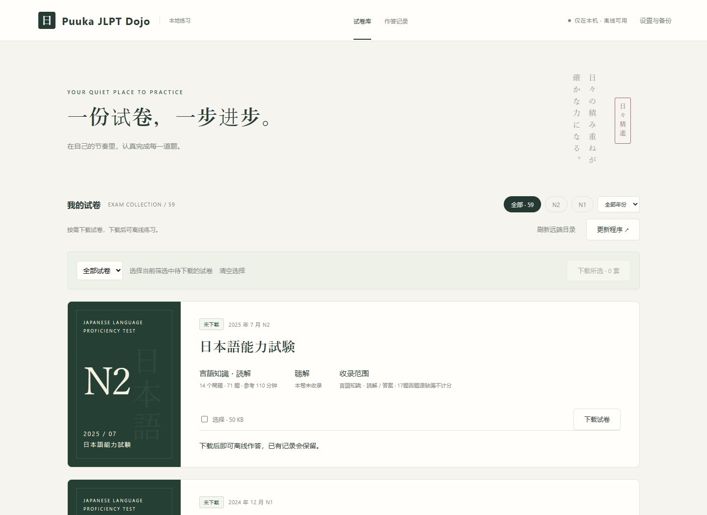
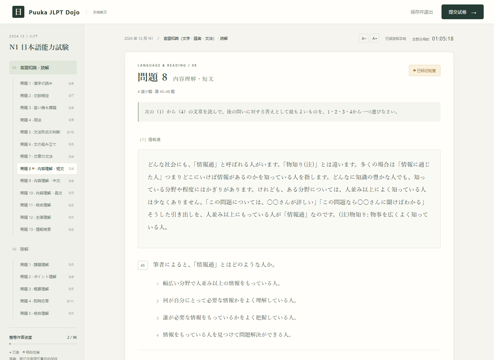
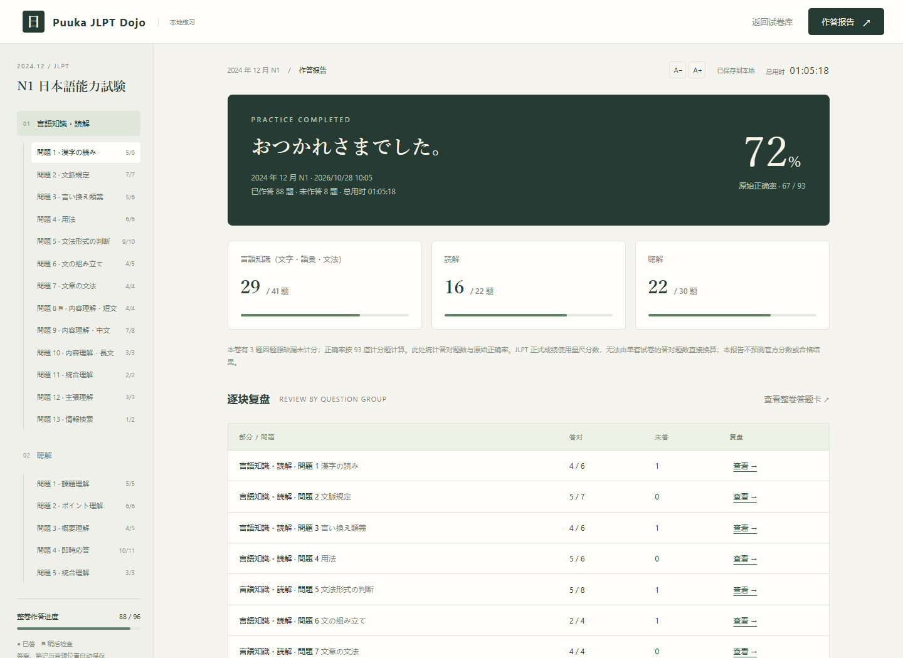

# Puuka JLPT Dojo / プーカ JLPT 道場

Puuka JLPT Dojo 是一个在电脑浏览器中使用的 JLPT 真题练习工具。可以选择试卷下载、作答、保存进度，并在交卷后查看答案和听力原文。

目前提供 **59 套 N1、N2 试卷**。不需要注册账号，下载后的试卷可以离线使用，作答记录保存在自己的电脑上。

## 功能

- **选择试卷下载**：按级别、年份筛选，支持单套下载和批量下载，并显示下载大小。
- **阅读与答题**：查看文章、注释、表格和关联小题，通过选项或答题卡作答，支持调整字号。
- **保存进度**：记录答案、笔记、待检查标记、用时和听力位置，可以分多次完成一份试卷。
- **听力练习**：支持暂停、变速和前后跳转；交卷后可按小题定位播放，并查看听力原文。
- **交卷复盘**：查看正确、错误和未答题，统计各部分答对题数与正确率，支持导出文字报告。
- **重复练习**：同一套试卷可以重新作答，之前的作答记录仍可查看。
- **备份与恢复**：导出进度备份，在另一台电脑上恢复答案、笔记和练习记录。

## 安装与启动

以下步骤适用于 Windows。

1. [下载程序 ZIP](https://git.zju.edu.cn/3240104224/puuka-jlpt-dojo/-/archive/master/puuka-jlpt-dojo-master.zip)，完整解压到固定文件夹，例如 `D:\Puuka-JLPT-Dojo`。不要在压缩包内运行。
2. 双击 **部署网站.cmd**，按提示等待部署完成。首次部署可能需要联网下载运行所需的组件。
3. 双击 **启动网站.cmd**，浏览器会打开 <http://127.0.0.1:3300>。
4. 在首页选择需要的试卷，下载完成后点击「开始作答」。

以后使用时，直接运行 **启动网站.cmd** 即可，不需要重复部署。

**练习期间保持服务窗口（一个黑色的终端窗口）开启。** 结束练习时，先点击「保存并退出」，再关闭服务窗口。

## 下载和管理试卷

程序下载包不含试卷和音频。首次打开时，需要联网下载想做的试卷。

- 点击「刷新远端目录」，查看可下载的试卷。
- 按级别、年份筛选后，可以单套下载，也可以勾选多套后点击「下载所选」。
- 标为「已下载」的试卷可以直接作答；标为「有更新」的试卷可以选择更新。
- 「移除本机文件」只删除该卷的试题和音频，保留答案、笔记和作答记录。以后重新下载该卷即可继续使用这些记录。

全部题库音频约 1.5 GB，不必一次下载。下载前可查看所选试卷的大小，并预留足够空间。

刷新目录、下载试卷和安装更新需要网络；已下载试卷的日常练习不需要联网。

## 作答与成绩

每页展示一组「問題」，可以自由切换。遇到不确定的内容，可以标记整组题稍后检查，或在笔记中记录。

计时只记录练习用时，**不会到时自动交卷**。确认交卷后，该轮答案锁定；需要重做时，请开始新一轮。

成绩显示答对题数和正确率，**不换算 JLPT 官方分数，也不判断是否合格**。个别题目因资料缺漏或答案存疑暂不计分，复盘时会说明原因。

「播放本题」会直接开始播放音频，在公共场所使用前请接好耳机。

详细操作见[使用指南](docs/USER-GUIDE.md)。截图中的作答记录仅作示例。

## 备份和换电脑

作答记录只保存在本机，不会自动同步到其他电脑。换电脑、重新安装或清理浏览器前，请先备份。

1. 打开「设置与备份」，点击「导出备份」，保存得到的文件。
2. 在新电脑安装并启动程序，下载需要的试卷。
3. 在「设置与备份」中点击「导入备份」，选择之前保存的文件。

**导入会替换当前记录，不会合并。** 导入前请先备份当前电脑上的记录。

「导出作答报告」生成的是文字报告，不能用于恢复进度。恢复进度请使用「导出备份」得到的文件。

## 更新程序

在首页点击「更新程序」，或在「设置与备份」中点击「检查更新」，确认后安装。也可以关闭服务窗口后，双击 **更新网站.cmd**。

更新完成后，重新运行 **启动网站.cmd**，再刷新网页。如果仍显示旧页面，可按 `Ctrl+F5`。

程序更新会保留已下载试卷和个人记录。试卷是否下载、是否更新，仍由你在首页选择。

## 题库范围

| 级别 | 套数 | 年月范围 | 其中不含听力 |
| --- | ---: | --- | ---: |
| N2 | 30 | 2010 年 7 月—2025 年 7 月 | 3 套 |
| N1 | 29 | 2010 年 7 月—2024 年 12 月 | 3 套 |

不含听力的试卷会明确标注「聴解：本卷未收录」，只提供言語知識・読解。2025 年 7 月 N1 因资料缺页没有收录。

各套试卷的题量、收录范围和不计分题号见[题库目录](docs/QUESTION-BANK.md)。发现题目问题时，请提供级别、年月、题号和具体错误。

## 常见问题

- **网页打不开**：检查服务窗口是否仍在运行，尝试重新启动，再打开 <http://127.0.0.1:3300>。
- **下载或更新失败**：先确认能访问[浙大 GitLab](https://git.zju.edu.cn/3240104224/puuka-jlpt-dojo)。校外访问请按学校网络要求连接。已有试卷仍可离线练习。
- **进度找不到**：确认使用的是原来的程序文件夹，并在首页「作答记录」中查找。不要急着清理数据或重新安装；有备份时可先备份当前记录，再导入旧备份。

更多问题见[使用指南](docs/USER-GUIDE.md#常见问题)。维护者请参阅[维护说明](docs/LIBRARY-MANAGEMENT.md)和[项目结构](docs/PROJECT-STRUCTURE.md)。

## 关于

本项目用于个人日语学习，与 JLPT 主办机构无关。试题、文章、角色图片及相关台词的权利归各自权利人所有，请勿商用。

作者：xi2p @ GitHub / CC98 · GPT-6.1 Sol
