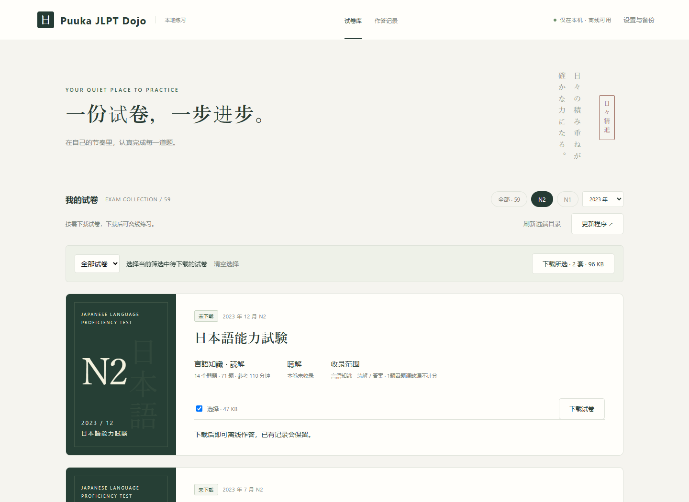
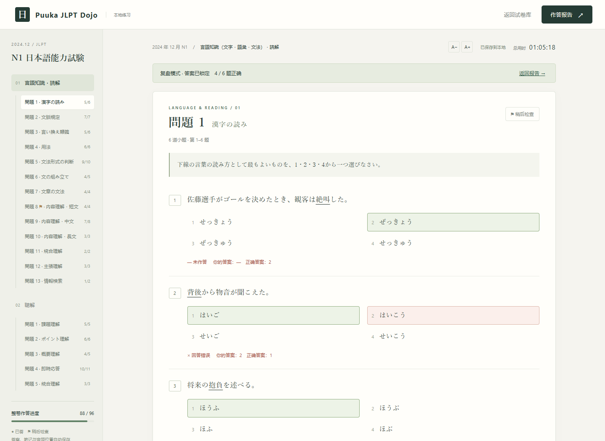

# 使用指南

## 选择试卷

先启动网站，再打开 <http://127.0.0.1:3300>。首页启动时会尝试刷新远端目录，也可手动点击「刷新远端目录」。目录只包含试卷信息，音频不会自动下载。

按级别、年份和下载状态筛选后，可逐套下载，或选择当前筛选中待下载的试卷，再点击「下载所选」。每卷会显示下载大小；完成后立即可以开始作答。已下载的试卷有更新时显示「有更新」，可单独或批量更新。

「移除本机文件」会删除该卷的试题和音频，保留作答记录与笔记，之后可以重新下载。已有用户的本机题库会自动识别，无需重下。离线时可继续使用已下载内容，远端目录使用上次缓存。



试卷卡片还会显示题量和已有作答记录。

- **继续作答**：接着上次未交卷的记录做题。
- **开始作答 / 重新作答**：新建作答记录，旧记录仍保留。
- **查看复盘**：打开已经交卷的记录。已交卷的历史记录可在首页「作答记录」中查找；其他未交卷记录可从设置恢复。

标有「聴解：本卷未收录」的试卷只包含言語知識・読解。它们可以正常作答、交卷和复盘，但不能作为完整的含听力模拟卷使用。


## 作答

每页对应原卷中的一组「問題」，正文、注释、表格及关联小题一起展示。侧栏用于切换题组；窄屏下可用题组选择框。

点击选项或答题卡中的数字作答，再次点击已选数字可以清空答案。答案会同步显示在两处。遇到不确定的内容，可以给**整组题**加上待检查标记，或在该组笔记中记录思路。标记不影响评分，交卷前可按标记回看。

`A−` / `A+` 可以调整字号。页面计时只记录用时，不会自动交卷。离开前点击「保存并退出」，并等保存完成；下次打开同一记录时可继续作答。


## 听力

有听力的试卷提供整卷音轨，支持 0.75、1、1.25、1.5 倍速和前后跳转 10 秒。小题的定位按钮从该题报号或对话开始处播放；同段对话的两个小问使用相同起点。

**「播放本题」会直接开始播放。** 在公共场所使用前请接好耳机。页面不会因进入试卷而自动播放音频。

部分听力题的题干或选项只存在于录音中，页面会提示听录音作答。听力原文在交卷后的复盘中显示，练习时不展示。

如果下载管理器或浏览器扩展干扰音频加载，可以使用播放器提供的本机 MP3 选择功能，选择这套试卷对应的音轨。不同版本的开场、停顿或剪辑会影响小题定位，尽量使用 `exams/<试卷ID>/assets/listening.mp3`。

## 交卷与复盘

交卷前会提示尚未完成的计分题数。确认后，该轮答案锁定；想重新作答时请开始新一轮。

复盘会标出正确、错误和未答题，显示参考答案，并提供错题定位。听力题可结合原文检查理解偏差。笔记仍可补充，方便整理词汇或记录误选原因。




以上截图使用示例记录，不包含个人练习数据。

正确率按这份试卷实际可计分的题目计算，未答的计分题仍计入总题数。资料缺漏或答案存疑的题目不参与评分和错题跳转，其原因在复盘的来源说明中列出。参考答案不一定能消除资料本身的疑义，请结合说明阅读。

这里的结果是练习统计，不是 JLPT 官方量尺分数，也不提供合格预测。

## 备份和换电脑

网站同时在本机文件和浏览器中保存记录，没有账号或云端同步。为避免误删或换浏览器造成损失，建议定期导出备份。

1. 在设置中导出进度，保存得到的 JSON 文件。
2. 在另一台电脑部署并启动网站，确认相应试卷已在题库中。
3. 在设置中导入 JSON，核对试卷、答案和笔记。

**导入会替换当前记录，不会合并两台电脑的练习。** 导入前先导出目标电脑的记录。备份文件上限为 5 MB；网站最多保留 100 条作答记录，长期练习时请另存重要记录。

复盘导出的 `.txt` 是可阅读的报告，不能作为进度备份导入。清除全部记录无法撤销，操作前先导出 JSON。

手动搬移项目时也可保留整个 `data/` 目录；仅重新下载项目不会带回原电脑的个人进度。

## 更新程序

更新源是[浙大 GitLab 项目](https://git.zju.edu.cn/3240104224/puuka-jlpt-dojo)的 `master` 分支。

- 在网页设置中检查更新，确认后安装。
- 或先关闭网站服务，再双击项目根目录的 **更新网站.cmd**。
- 更新完成后，关闭旧服务并重新启动，再刷新网页。若仍显示旧版，可按 `Ctrl+F5` 强制刷新。

程序更新保留个人进度、运行环境和本机试卷，不会下载全部题库。试卷从首页单独下载或更新，不需要导入 ZIP；更新某套试卷会替换该卷的本地文件，自行修改过的内容请先另存。

网页默认检查新版本，可在设置中关闭自动检查。检查不等于安装，网络不可用也不影响已有试卷练习。

## 常见问题

### 无法访问项目或下载更新

先确认浏览器能访问浙大 GitLab。校外访问请按学校的网络要求连接。刷新目录、下载试卷和更新程序需要网络，已下载试卷的日常练习不需要。

### 浏览器打不开本机网站

检查服务窗口是否仍在运行，并确认地址是 `http://127.0.0.1:3300`。如果端口被其他程序占用，可在项目目录的 PowerShell 中运行：

```powershell
$env:JLPT_PORT = '3301'
npm start
```

然后打开 `http://127.0.0.1:3301`。以后使用哪个端口，就访问对应地址。

### 关闭网页后还需要关闭什么

关闭浏览器标签页不会停止本机服务。结束练习后，可在服务窗口按 `Ctrl+C` 或关闭窗口；下次重新启动即可。

### 进度不见了

先确认启动的是原来的项目文件夹，使用的是原来的浏览器，并在设置中检查历史记录。不要急着清理浏览器数据或覆盖 `data/progress.json`。有导出的 JSON 时，可先备份当前状态，再恢复旧备份。

### 题库少了一套，或出现加载提示

先查看[题库目录](QUESTION-BANK.md)是否包含该卷。文件缺失、格式错误或重复 ID 都可能导致试卷无法加载；维护者可以访问 `/api/library-status` 查看扫描结果。2025 年 7 月 N1 因来源缺页没有入库，并非更新失败。
